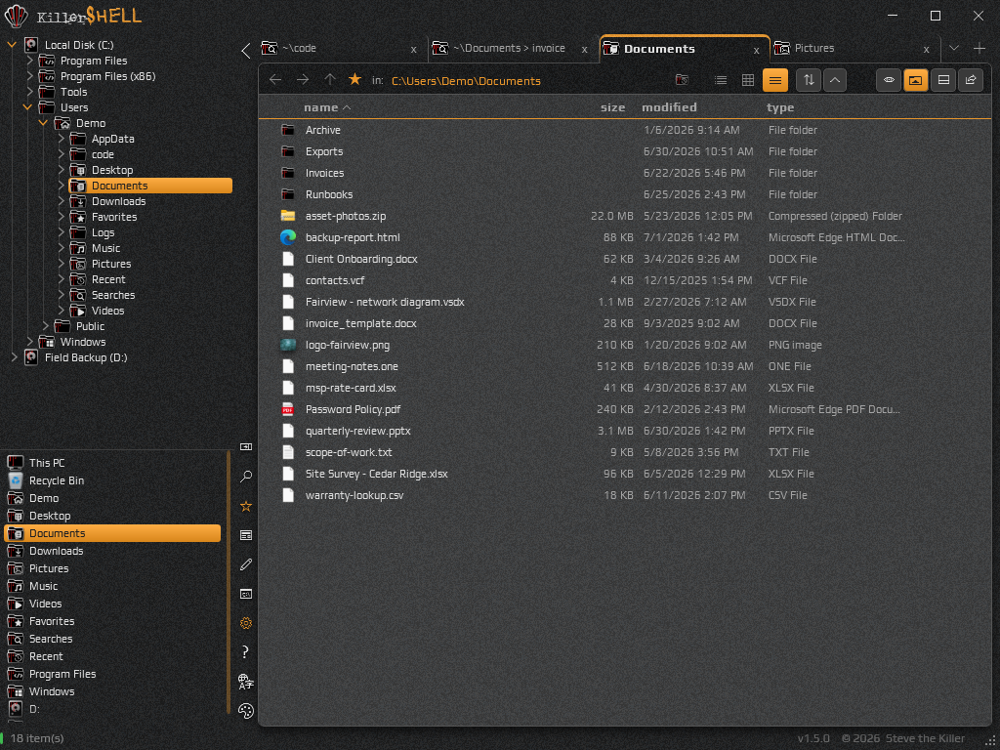
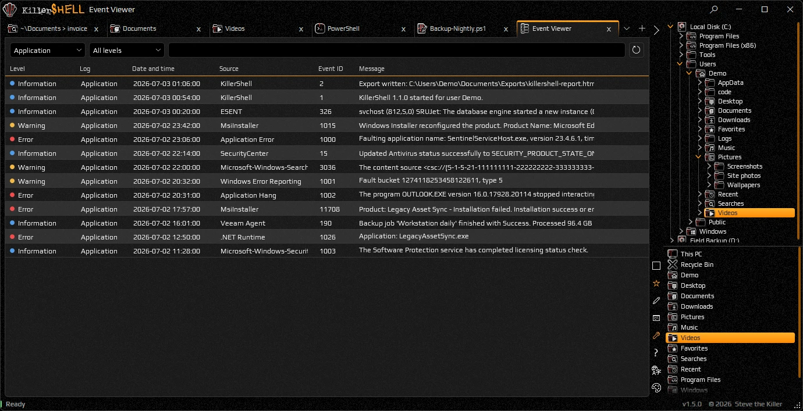
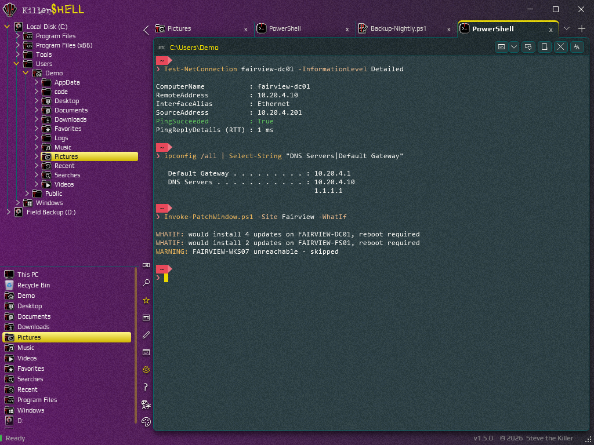
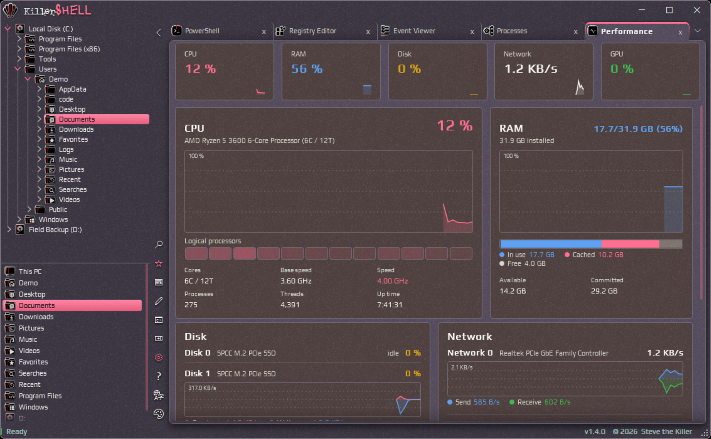

<p align="center">
  <a href="https://killershell.net"></a>
</p>

Free and open-source Windows shell for power users. A file browser, terminal, text editor, search engine, and administration toolkit share one window, one tab strip, and one set of keys.

KillerShell is one portable EXE with no agent, account, telemetry, or separate runtime installer. Run it from anywhere, install it for your account, or install it machine-wide for every user.

Full how-tos live on the [help page](https://killershell.net/help.html); architecture, formats, security decisions, and implementation details are on the [technical page](https://killershell.net/technical.html).

## Features

- Browse folders in list, icon, or details view with tabs, favorites, a folder tree, live filesystem updates, and two panes arranged side by side or stacked
- Search names with wildcards or stream file contents with 2 to 16 workers, with multiple ANY/ALL terms, filters, chained searches, and HTML or CSV export
- Use saved terminal profiles for PowerShell, CMD, WSL, or custom commands, choose a default shell, and track its working folder live; edit the themed PowerShell or Bash prompt, or your PowerShell profile
- Browse installed WSL distributions, pin Linux folders, and open a terminal in the selected Linux directory
- Edit text with syntax highlighting, find, go to line, undo/redo, encoding and line-ending preservation, indentation controls, and a dedicated font setting
- Copy, move, rename, recycle, permanently delete, and drag files to or from Explorer, with asynchronous progress and Replace, Skip, or Keep both collision handling
- Work with ZIP archives, including empty folders and complete folder-tree drag-out, without changing the original when a rewrite is canceled
- Inspect and manage processes and services, including live CPU and memory sorting, filtering, ownership, restart, and elevation where needed
- Monitor CPU, RAM, disks, networks, and GPUs with live graphs and per-core CPU history
- Use the built-in Event Viewer, Registry Editor, and Storage Analyzer without leaving the tab strip
- Keyboard-first operation using familiar Explorer keys plus F4 storage, F7 edit, F8 shell, F9 processes, F10 split, F11 performance, and F1 for the complete shortcut overlay
- Read-only JSON CLI queries for files, processes, services, event logs, registry keys, and drives; run `KillerShell --cli --help` for commands
- Thirteen themes, including a full 98SE recreation; eight accents on Dark, Light, Black, and 98SE give 41 looks
- Localized in 20 languages, with live switching and English fallback for incomplete translations
- Runs portable or self-installs per-user without UAC or machine-wide with UAC; `/silent` supports WinGet and managed deployment
- Local-only: no indexing service, cloud account, advertisements, or telemetry

## Screenshots

<table>
<tr>
<td width="50%"><br><sub>Give each pane its own tabs and view, with list and details views side by side.</sub></td>
<td width="50%"><br><sub>Edit a PowerShell script with syntax highlighting while keeping files in the other pane.</sub></td>
</tr>
<tr>
<td><br><sub>Run PowerShell in a tab, with a themed prompt and room to read command output.</sub></td>
<td><br><sub>Watch CPU, RAM, disk and network activity together in the built-in Performance Monitor.</sub></td>
</tr>
</table>

## Requirements

- Windows 10 or 11 (x64)
- .NET Framework 4.8, included with every supported Windows release

## Download

WinGet:

```powershell
winget install SteveTheKiller.KillerShell
```

Chocolatey:

```powershell
choco install killershell
```

- Prebuilt binary: <https://github.com/SteveTheKiller/KillerShell/releases/latest/download/KillerShell.exe>
- Source (GPL3 corresponding source for each release): <https://github.com/SteveTheKiller/KillerShell/releases/latest>

## Build from source

Open `KillerShell.sln` in Visual Studio 2022 and build, or run:

```powershell
dotnet publish KillerShell.csproj -c Release
```

The app targets .NET Framework 4.8. AvalonEdit is vendored under `third_party/AvalonEdit` and compiled directly into KillerShell, so the published app remains one portable executable. `release.ps1` also produces the versioned GPL3 source archive shipped with each release.

## Translations

UI strings live in `Strings/`, one XAML `ResourceDictionary` per locale. To add or improve a language, see [TRANSLATING.md](TRANSLATING.md). Missing keys fall back to English, so a partial translation is welcome.

## Changelog

See [CHANGELOG.md](CHANGELOG.md).

## License

GPLv3. See [LICENSE](LICENSE). If you fork, modify, or redistribute KillerShell, your version must also be released under GPLv3 with source available.

Bundled components retain their own licenses:

- AvalonEdit - MIT ([license](third_party/AvalonEdit/LICENSE))
- `Fonts/KillerGlyphs.ttf`, a Terminess Nerd Font subset - SIL OFL 1.1 ([notice](Fonts/KillerGlyphs-NOTICE.txt), [license](Fonts/KillerGlyphs-OFL.txt))
- 98SE icons from [Chicago95](https://github.com/grassmunk/Chicago95) - GPL-3.0+/MIT ([attribution](Resources/icons/98/ATTRIBUTION.md))
